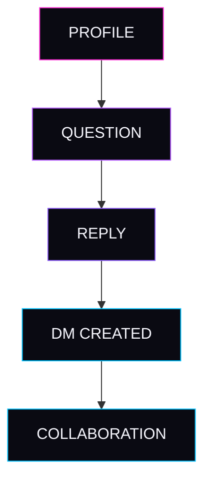
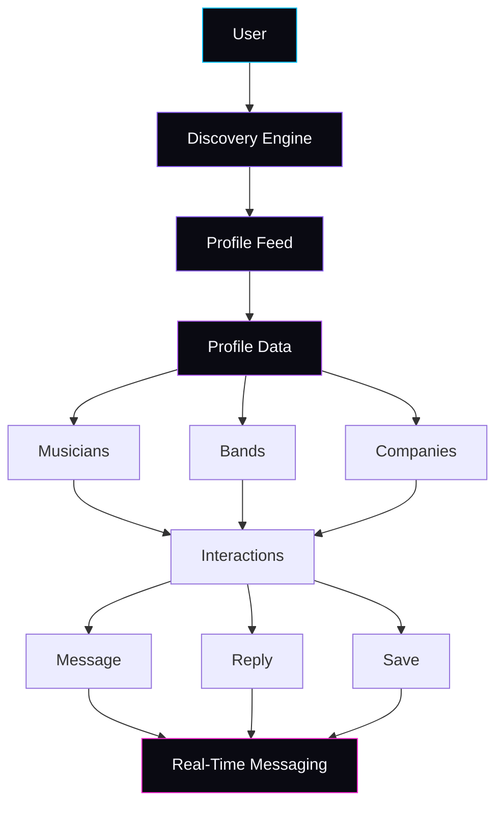
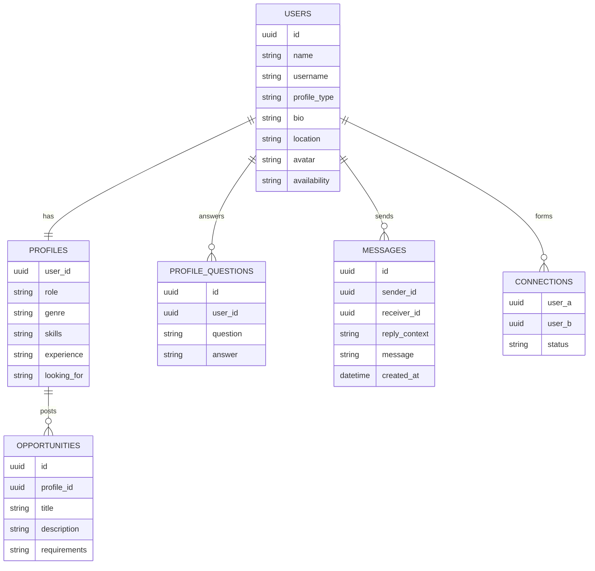
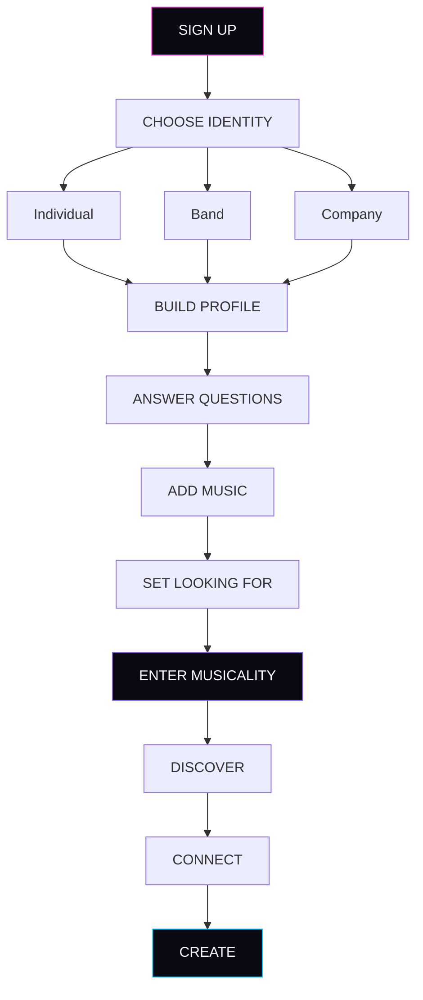

<div align="center">

<br/>
> A discovery and collaboration network for musicians, producers, composers, bands, labels, studios, and the people building music.
 
<br/>


 
<br/>


 
</div>
<br/>

## WHAT IF LINKEDIN ACTUALLY FELT LIKE MUSIC?
 
Musicality is a professional discovery network built around sound instead of résumés.
 
<table>
<tr>
<td width="50%" valign="top">
**Musicians** discover musicians
**Producers** discover singers
**Bands** find members
**Composers** find projects
 
</td>
<td width="50%" valign="top">
**Studios** find talent
**Labels** discover creators
**Companies** discover creators
**Creators** discover companies
 
</td>
</tr>
</table>
No résumés. No cover letters. Just profiles built the way an artist actually thinks — genre, sound, taste, and what you're looking to make next.
 
<br/>

## THE MUSICALITY ECOSYSTEM
 

<br/>

## DISCOVER PEOPLE LIKE YOU DISCOVER MUSIC.
 
Users scroll vertically through complete music profiles. Once they reach the bottom of one profile, continuing to scroll transitions naturally into the next — a feed built like a playlist, not a directory.
 
<div align="center">
<table>
<tr><td>
```
╭──────────────────────────────────────────╮
│                                            │
│   MAYA KAPOOR                             │
│   Vocalist • Songwriter                   │
│   Alternative R&B                         │
│   Bengaluru, India                        │
│                                            │
│   LOOKING FOR                             │
│   → Music Producer                        │
│                                            │
│   "If you're obsessed with cinematic      │
│    synths, we'll probably make            │
│    something insane."                     │
│                                            │
│              [ MESSAGE ]                  │
│                                            │
╰──────────────────────────────────────────╯
              ░░░ next profile ░░░
              ╰──────────────────╯
```
 
</td></tr>
</table>
**SCROLL ↓ · NEXT PROFILE**
 
</div>
Three stacked profiles, gradient borders, one continuous feed — discovery that feels like listening, not searching.
 
<br/>
## PROFILE TYPES
 
<table>
<tr>
<td align="center" width="33%">
**01**
### INDIVIDUAL
Musicians
Producers
Singers
Composers
 
</td>
<td align="center" width="33%">
**02**
### BAND
Bands
Duos
Collectives
 
</td>
<td align="center" width="33%">
**03**
### ORGANIZATION
Labels
Studios
Companies
Recruiters
 
</td>
</tr>
</table>
<br/>
## YOUR PROFILE ISN'T A RÉSUMÉ.
 
Prompt cards, inspired by how people actually talk about music — not how they talk about jobs.
 
> **THE ARTIST WHO CHANGED HOW I HEAR MUSIC**
> Radiohead changed how I think about production.
 
> **WE'LL WORK WELL TOGETHER IF**
> You care about weird ideas more than safe ones.
 
> **MY DREAM PROJECT**
> An orchestral electronic album performed live.
 
<br/>
## OPPORTUNITY SYSTEM
 
Users can attach custom opportunity prompts directly to their profile.
 
```
┌──────────────────────────────────────────┐
│  LOOKING FOR                              │
│  🎼 FILM COMPOSER                         │
│  Northlight Studios                       │
│                                            │
│  "We need someone who can blend           │
│   orchestral scoring with experimental    │
│   electronic production."                 │
│                                            │
│              [ REPLY ]                    │
└──────────────────────────────────────────┘
```
 
<br/>
### QUESTION → MESSAGE FLOW
 

 
<br/>
## MESSAGING
 
A premium dark-mode DM interface, built around reply-context rather than cold outreach.
 
```
╭─────────────────────────────────────────╮
│  NORTHLIGHT STUDIOS                      │
│                                           │
│  Replying to:                            │
│  "If you know orchestral + electronic    │
│   scoring, you'll fit here."             │
│                                           │
│                            YOU  ┐        │
│      That's exactly the type of │        │
│      music I make. I've scored  │        │
│      two short films recently.  ┘        │
│                                           │
│  ┌ NORTHLIGHT STUDIOS                    │
│  │ Send us your work.                    │
│                                           │
╰─────────────────────────────────────────╯
```
 
<br/>
## NAVIGATION
 
<div align="center">

</div>
<br/>
## DISCOVERY ARCHITECTURE
 

 
<br/>
## TECH STACK
 
<table>
<tr>
<td valign="top" width="25%">
### Frontend
Next.js
React
TypeScript
Tailwind CSS
Framer Motion
 
</td>
<td valign="top" width="25%">
### Backend
Node.js
Supabase / PostgreSQL
 
### Realtime
WebSockets
Supabase Realtime
 
</td>
<td valign="top" width="25%">
### Auth
OAuth
Google
Spotify
 
### Media
Spotify API
YouTube API
SoundCloud
 
</td>
<td valign="top" width="25%">
### Storage
Supabase Storage
 
### Deployment
Vercel
 
</td>
</tr>
</table>
<br/>
## DATABASE DESIGN
 

 
<br/>
## APP FLOW
 

 
<br/>
## MUSIC PLAYER
 
<div align="center">

</div>
<br/>
## ROADMAP
 
<table>
<tr><td valign="top" width="25%">
**PHASE 01**
Profile system
Discovery feed
Question prompts
Messaging
 
</td><td valign="top" width="25%">
**PHASE 02**
Spotify integration
Audio previews
Recommendation engine
Advanced search
 
</td><td valign="top" width="25%">
**PHASE 03**
AI collaborator matching
Creator verification
Band recruitment
Company dashboards
 
</td><td valign="top" width="25%">
**PHASE 04**
Global music talent network
 
</td></tr>
</table>
<br/>
## PROJECT STRUCTURE
 
```
musicality/
├── app/
│   ├── discover/
│   ├── explore/
│   ├── messages/
│   ├── profile/
│   └── view/
│
├── components/
│   ├── ProfileCard.tsx
│   ├── MusicPlayer.tsx
│   ├── QuestionCard.tsx
│   ├── OpportunityCard.tsx
│   └── Navigation.tsx
│
├── lib/
│   ├── database.ts
│   ├── matching.ts
│   └── auth.ts
│
├── assets/
│   ├── hero.svg
│   ├── ecosystem.svg
│   ├── nav.svg
│   ├── player.svg
│   ├── footer.svg
│   ├── divider-waveform.svg
│   ├── divider-orbit.svg
│   └── divider-particles.svg
│
├── public/
│
└── README.md
```
 
<br/>
<div align="center">

</div>
